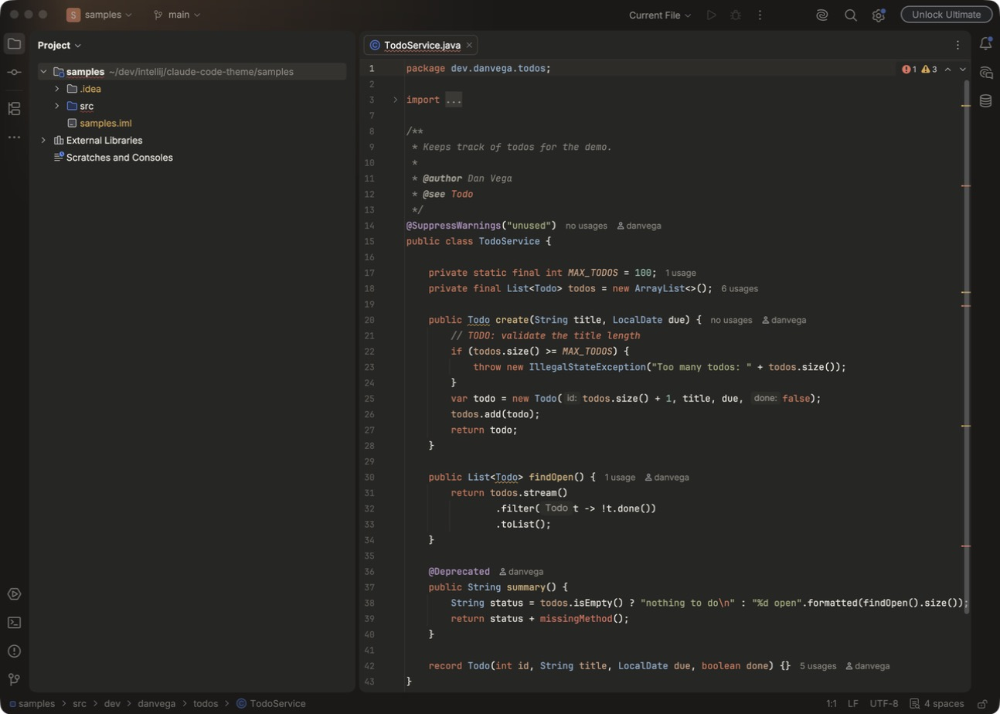
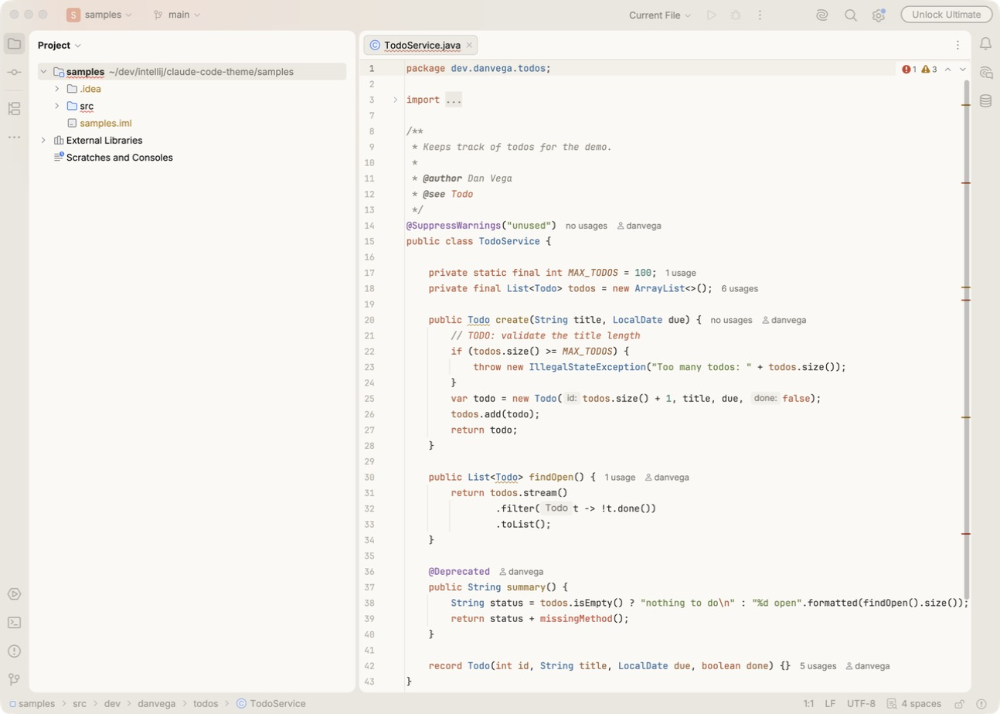

# Kiln Theme for IntelliJ

A warm dark and light theme for JetBrains IDEs. It uses charcoal and cream surfaces, a clay orange accent, and calm, earthy syntax colors. Each variant recolors the whole IDE, the editor, and the terminal.





## Install

You need IntelliJ IDEA 2026.2 or newer.

1. Download `kiln-theme-<version>.zip` from the [latest release](../../releases/latest). Do not unzip it.
2. In IntelliJ, open **Settings | Plugins**, click the gear icon, and choose **Install Plugin from Disk**. Pick the zip.
3. Open **Settings | Appearance & Behavior | Appearance** and set **Theme** to **Kiln Dark** or **Kiln Light**.

The editor color scheme switches with the theme. If your code keeps its old colors, set **Settings | Editor | Color Scheme** to the matching Kiln scheme.

Kiln is tested with IntelliJ IDEA 2026.2.3. Other JetBrains IDEs on 2026.2 or newer share the same theme system, but they are not tested yet.

## Build from source

You need a JDK 17 or newer.

```bash
./gradlew buildPlugin
```

This writes `build/distributions/kiln-theme-0.1.0.zip`. The first build downloads IntelliJ IDEA 2026.2.3 to build against, which takes a few minutes. To use an IDE you already have, pass its install folder:

```bash
./gradlew buildPlugin -PlocalIdePath="/Applications/IntelliJ IDEA.app"
```

On Windows and Linux, pass the folder that contains the IDE's `bin` and `lib` folders.

## Try it in a sandbox IDE

```bash
./gradlew runIde
```

This starts a separate IDE with the plugin installed and opens [samples/src/dev/danvega/todos/TodoService.java](samples/src/dev/danvega/todos/TodoService.java). The sample has keywords, strings, annotations, fields, constants, Javadoc, a TODO, a warning, and an error, so most syntax colors are on screen at once. Pick a Kiln theme in the sandbox's settings the first time.

## Change the colors

The palettes live in [scripts/generate_themes.py](scripts/generate_themes.py). Edit the `DARK` or `LIGHT` dictionary, then regenerate the theme files. You need Python 3.

```bash
./gradlew generateThemes
```

This rewrites the four files in [src/main/resources/themes](src/main/resources/themes) and prints the contrast ratio of each syntax color against the editor background. Commit the regenerated files with your palette change. The build checks that they match the palettes.

## Release a new version

1. Set `pluginVersion` in [gradle.properties](gradle.properties).
2. Commit, then tag the commit with the same version and push the tag:

```bash
git tag v0.1.0
git push origin v0.1.0
```

The [Build workflow](.github/workflows/build.yml) builds the plugin, then creates a GitHub release with the zip attached. It stops if the tag and `pluginVersion` do not match.

## Good to know

- Kiln inherits from JetBrains' Islands themes (`Islands Dark` and `Islands Light`). Islands switched to its current color tokens in 2026.2, so older versions are not supported.
- Islands resolves its own named colors before a child theme's colors apply. Overriding one token does not reach the keys that point at it through another name. So the generator reads every Islands token from the IDE, resolves it through the Kiln palette, and writes all of them out as hex values. Do not hand-edit the generated files.
- The editor schemes use Darcula and Default as their parents. Those parents set some Java and Kotlin keys directly, so the schemes set those keys too, not only the `DEFAULT_*` ones.
